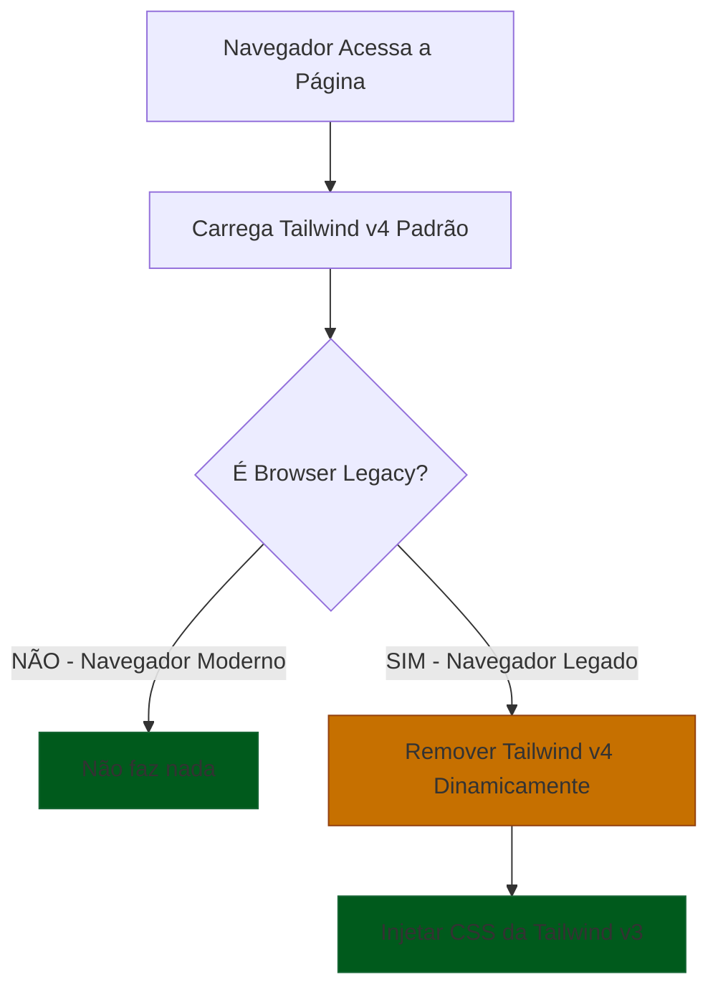

# vite-plugin-tailwind-legacy

⚡ Plugin Vite que transforma CSS do Tailwind v4 para compatibilidade com navegadores legados usando PostCSS.

[](https://www.npmjs.com/package/vite-plugin-tailwind-legacy)
[](https://opensource.org/licenses/MIT)

> 🇺🇸 [English version](./README.md) | 🇧🇷 Português

## ✨ Por que usar?

**Problema:**
- ❌ Tailwind v4 usa recursos CSS modernos como `oklch()` que quebram em navegadores antigos
- ❌ Polyfills convencionais não resolvem completamente o problema
- ❌ Manter duas versões do CSS manualmente é trabalhoso

**Solução:**
- ✅ Captura o CSS gerado pelo Tailwind v4 e aplica transformações PostCSS
- ✅ Gera um novo CSS compatível e o injeta nos HTMLs da build para navegadores antigos
- ✅ ZERO impacto em navegadores modernos (carregam o CSS original)
- ✅ Apenas navegadores legados recebem o CSS transformado
- ✅ Não precisa mais instalar Tailwind v3 separadamente

## 🚀 Instalação

```bash
npm install --save-dev vite-plugin-tailwind-legacy@latest
# ou
yarn add vite-plugin-tailwind-legacy@latest --dev
```

## ⚙️ Configuração

```javascript
import { defineConfig } from 'vite'
import tailwindcss from '@tailwindcss/vite'
import TailwindLegacyPlugin from 'vite-plugin-tailwind-legacy'

export default defineConfig(({ command }) => {
  const isBuild = command === 'build'

  return {
    plugins: [
      react(),
      tailwindcss(),
      TailwindLegacyPlugin({
        assetsDir: 'dist/assets',
        publicPath: '/static/assets/',
        buildDir: 'dist',
        injectInHTML: true,
        deleteStyles: ['app', 'layout'],
        outputCSSName: 'tailwind-legacy.css',
        browserScriptName: 'browser-check.js',
      })
    ],
  }
})
```

## 🎯 O Que o Plugin Faz

O plugin captura o CSS gerado pelo Tailwind v4, aplica transformações PostCSS, gera um novo CSS compatível e o injeta nos HTMLs da build para navegadores antigos.

### 1. 🎨 Transformações de Cores

| Recurso | Antes (v4) | Depois (legado) |
|---------|------------|-----------------|
| oklch() | `oklch(0.65 0.15 250)` | `rgb(123, 104, 238)` |
| color-mix() | `color-mix(in oklab, #1445e2 70%, #4f46e5 30%)` | `rgb(35, 75, 228)` |
| Opacidade | `bg-primary/50` | `rgba(20, 69, 226, 0.5)` |
| Variáveis com opacidade | `var(--primary) / 0.5` | `rgba(20, 69, 226, 0.5)` |

### 2. 📐 Transformações de Layout

| Recurso | Antes (v4) | Depois (legado) |
|---------|------------|-----------------|
| space-y | `.space-y-4 > *:not(:last-child)` | `margin-bottom: 16px` |
| space-x | `.space-x-4 > *:not(:last-child)` | `margin-right: 16px` |
| gap | `.gap-4` | `margin: 8px` (todos os lados) |
| gap-x | `.gap-x-4` | `margin-left: 8px; margin-right: 8px` |
| gap-y | `.gap-y-4` | `margin-top: 8px; margin-bottom: 8px` |

### 3. 🔄 Transformações CSS

```css
/* Antes (v4) */
.rotate-45 {
  rotate: 45deg;
}

/* Depois (legado) */
.rotate-45 {
  transform: rotate3d(0, 0, 1, 45deg);
}
```

```css
/* Antes (v4) */
.scale-150 {
  scale: 1.5;
}

/* Depois (legado) */
.scale-150 {
  transform: scale3d(1.5, 1.5, 1);
}
```

```css
/* Antes (v4) */
.translate-10 {
  translate: 10px 20px;
}

/* Depois (legado) */
.translate-10 {
  transform: translate3d(10px, 20px, 0);
}
```

## 🔧 Opções de Configuração

| Opção | Tipo | Padrão | Descrição |
|-------|------|--------|-----------|
| `assetsDir` | `string` | `'dist/client/assets'` | Diretório de saída dos assets |
| `publicPath` | `string` | `'/static/assets/'` | Caminho público para carregar assets |
| `buildDir` | `string` | `'dist'` | Diretório de saída da build |
| `injectInHTML` | `boolean` | `true` | Injetar script automaticamente no HTML |
| `deleteStyles` | `string[]` | `[]` | Padrões de CSS para remover em navegadores legados |
| `outputCSSName` | `string` | `'tailwind-v3-legacy.css'` | Nome do arquivo CSS de saída |
| `browserScriptName` | `string` | `'browser-check.js'` | Nome do script de verificação |
| `colorFormat` | `'rgb' \| 'hsl'` | `'rgb'` | Formato de saída das cores |

## 🔄 Compatibilidade com Navegadores

| Navegador | Moderno (v4) | Legado (fallback) |
|-----------|--------------|-------------------|
| Chrome    | 111+         | 87 a 110          |
| Edge      | 111+         | 87 a 110          |
| Firefox   | 128+         | 83 a 127          |
| Safari    | 16.4+        | 14.0 a 16.3       |
| Opera     | 90+          | 73 a 89           |

## ❓ Como funciona?

1 - O `vite-plugin-tailwind-legacy` cria um arquivo CSS baseado na v3 para navegadores antigos

2 - Adiciona um script aos HTMLs que verifica se é um navegador antigo. Se for, ele usa o `output.css` como fallback para navegadores antigos.

### 🔄 Fluxo `vite-plugin-tailwind-legacy`



## 🚀 Performance

- **Impacto zero** em navegadores modernos (nenhum CSS extra carregado)
- **Impacto mínimo** em navegadores legados (apenas uma requisição HTTP adicional)
- CSS gerado é minificado para produção

## 🤝 Contribuindo

Contribuições são bem-vindas! Leia nosso [Guia de Contribuição](CONTRIBUTING.md).

---

## 📌 Versão Antiga (v1)

Se você precisa da versão que usava Tailwind CSS v3 separadamente, consulte a [documentação da v1](./v1/README-pt.md).

A v1 utilizava uma abordagem diferente: gerava um CSS separado com Tailwind v3 para navegadores legados. A v2 é mais rápida e eficiente, transformando o CSS do Tailwind v4 diretamente com PostCSS.

**Recomendamos usar a v2 para novos projetos.**

## 📚 Documentação Adicional

- [Guia de Integração Backend](./BACKEND-INTEGRATION.md)
- [Exemplos](./v1/examples/images/)