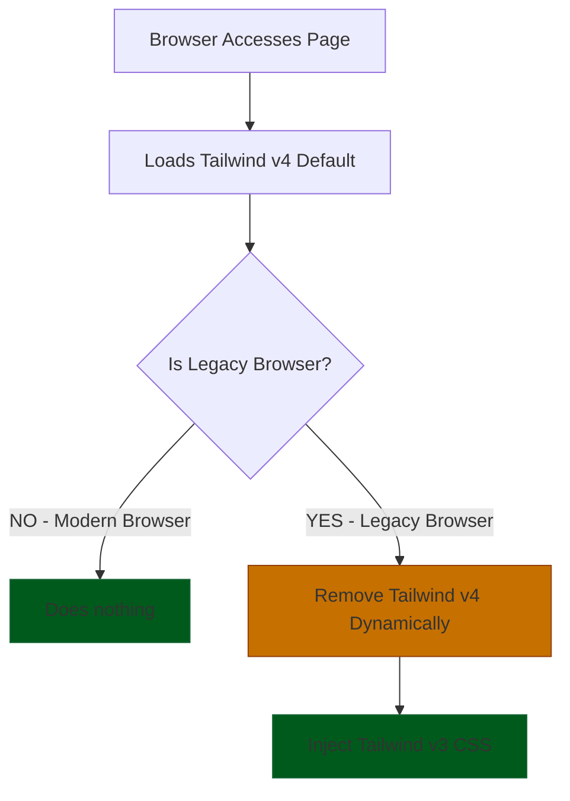

# vite-plugin-tailwind-legacy

⚡ Vite plugin that transforms Tailwind v4 CSS for legacy browser compatibility using PostCSS.

[](https://www.npmjs.com/package/vite-plugin-tailwind-legacy)
[](https://opensource.org/licenses/MIT)

> 🇺🇸 English | 🇧🇷 [Versão em Português](./README-pt.md)

## ✨ Why use it?

**Problem:**
- ❌ Tailwind v4 uses modern CSS features like `oklch()` that break in older browsers
- ❌ Conventional polyfills don't completely solve the problem
- ❌ Maintaining two CSS versions manually is time-consuming

**Solution:**
- ✅ Captures the CSS generated by Tailwind v4 and applies PostCSS transformations
- ✅ Generates a new compatible CSS and injects it into build HTMLs for older browsers
- ✅ ZERO impact on modern browsers (they load the original CSS)
- ✅ Only legacy browsers receive the transformed CSS
- ✅ No need to install Tailwind v3 separately

## 🚀 Installation

```bash
npm install --save-dev vite-plugin-tailwind-legacy@latest
# or
yarn add vite-plugin-tailwind-legacy@latest --dev
```

## ⚙️ Configuration

```javascript
import { defineConfig } from 'vite'
import tailwindcss from '@tailwindcss/vite'
import TailwindLegacyPlugin from 'vite-plugin-tailwind-legacy'

export default defineConfig(({ command }) => {
  const isBuild = command === 'build'

  return {
    plugins: [
      react(),
      tailwindcss(),
      TailwindLegacyPlugin({
        assetsDir: 'dist/assets',
        publicPath: '/static/assets/',
        buildDir: 'dist',
        injectInHTML: true,
        deleteStyles: ['app', 'layout'],
        outputCSSName: 'tailwind-legacy.css',
        browserScriptName: 'browser-check.js',
      })
    ],
  }
})
```

## 🎯 What the Plugin Does

The plugin captures the CSS generated by Tailwind v4, applies PostCSS transformations, generates a new compatible CSS, and injects it into the build HTMLs for older browsers.

### 1. 🎨 Color Transformations

| Feature | Before (v4) | After (legacy) |
|---------|------------|-----------------|
| oklch() | `oklch(0.65 0.15 250)` | `rgb(123, 104, 238)` |
| color-mix() | `color-mix(in oklab, #1445e2 70%, #4f46e5 30%)` | `rgb(35, 75, 228)` |
| Opacity | `bg-primary/50` | `rgba(20, 69, 226, 0.5)` |
| Variables with opacity | `var(--primary) / 0.5` | `rgba(20, 69, 226, 0.5)` |

### 2. 📐 Layout Transformations

| Feature | Before (v4) | After (legacy) |
|---------|------------|-----------------|
| space-y | `.space-y-4 > *:not(:last-child)` | `margin-bottom: 16px` |
| space-x | `.space-x-4 > *:not(:last-child)` | `margin-right: 16px` |
| gap | `.gap-4` | `margin: 8px` (all sides) |
| gap-x | `.gap-x-4` | `margin-left: 8px; margin-right: 8px` |
| gap-y | `.gap-y-4` | `margin-top: 8px; margin-bottom: 8px` |

### 3. 🔄 CSS Transformations

```css
/* Before (v4) */
.rotate-45 {
  rotate: 45deg;
}

/* After (legacy) */
.rotate-45 {
  transform: rotate3d(0, 0, 1, 45deg);
}
```

```css
/* Before (v4) */
.scale-150 {
  scale: 1.5;
}

/* After (legacy) */
.scale-150 {
  transform: scale3d(1.5, 1.5, 1);
}
```

```css
/* Before (v4) */
.translate-10 {
  translate: 10px 20px;
}

/* After (legacy) */
.translate-10 {
  transform: translate3d(10px, 20px, 0);
}
```

## 🔧 Configuration Options

| Option | Type | Default | Description |
|--------|------|---------|-------------|
| `assetsDir` | `string` | `'dist/client/assets'` | Output directory for assets |
| `publicPath` | `string` | `'/static/assets/'` | Public path to load assets |
| `buildDir` | `string` | `'dist'` | Build output directory |
| `injectInHTML` | `boolean` | `true` | Automatically inject script into HTML |
| `deleteStyles` | `string[]` | `[]` | CSS patterns to remove in legacy browsers |
| `outputCSSName` | `string` | `'tailwind-v3-legacy.css'` | Output CSS file name |
| `browserScriptName` | `string` | `'browser-check.js'` | Browser check script name |
| `colorFormat` | `'rgb' \| 'hsl'` | `'rgb'` | Output color format |

## 🔄 Browser Compatibility

| Browser | Modern (v4) | Legacy (fallback) |
|---------|-------------|-------------------|
| Chrome  | 111+        | 87 to 110         |
| Edge    | 111+        | 87 to 110         |
| Firefox | 128+        | 83 to 127         |
| Safari  | 16.4+       | 14.0 to 16.3      |
| Opera   | 90+         | 73 to 89          |

## ❓ How it Works?

1 - `vite-plugin-tailwind-legacy` creates a CSS file based on v3 for older browsers

2 - Adds a script to HTMLs that checks if it's an older browser. If so, it uses `output.css` as fallback for older browsers.

### 🔄 `vite-plugin-tailwind-legacy` Flow



## 🚀 Performance

- **Zero impact** on modern browsers (no extra CSS loaded)
- **Minimal impact** on legacy browsers (just one additional HTTP request)
- Generated CSS is minified for production

## 🤝 Contributing

Contributions are welcome! Please read our [Contributing Guide](CONTRIBUTING.md).

---

## 📌 Old Version (v1)

If you need the version that used Tailwind CSS v3 separately, check the [v1 documentation](./v1/README.v1.md).

v1 used a different approach: it generated a separate CSS with Tailwind v3 for legacy browsers. v2 is faster and more efficient, transforming Tailwind v4 CSS directly with PostCSS.

**We recommend using v2 for new projects.**

## 📚 Additional Documentation

- [Backend Integration Guide](./BACKEND-INTEGRATION.md)
- [Examples](./v1/examples/images/)